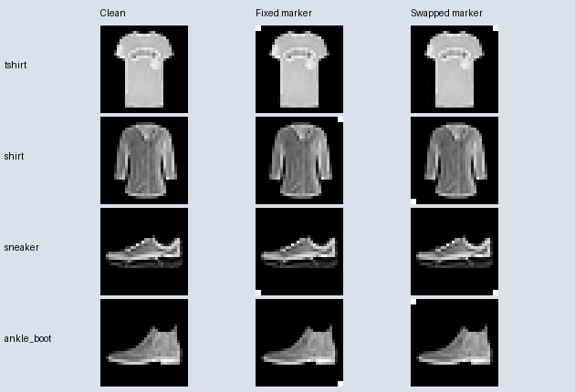

# Clothing classification with corner markers

Does a clothing classifier learn clothing features or a white corner marker?
We compare two questions:

1. How much does accuracy drop when a class-specific marker is removed or swapped?
2. Does training with balanced random markers reduce this drop?

## Files

| File or folder | Purpose |
| --- | --- |
| `data.py` | Download Fashion-MNIST, create PNG images, and read images for training or testing |
| `train.py` | Build and train one CNN for each of the three training conditions |
| `evaluate.py` | Load saved models and create accuracy and macro-F1 tables |
| `models/seed_42/` | Three pretrained models and their original training settings |
| `requirements.txt` | Python package versions for pip |
| `environment.yml` | Conda environment with the same package versions |
| `datasets/previews/marker_examples.png` | Example images |
| `third_party/Fashion-MNIST-LICENSE.txt` | Original dataset license |

## Installation

Download the repository ZIP and extract it, or clone it.
For ZIP downloads, open a terminal in the extracted folder containing `data.py`
and `requirements.txt`. For Git:

```bash
git clone https://github.com/mintleaf0831/pa04-marker-shortcuts.git
cd pa04-marker-shortcuts
```

Choose one setup method. The recorded runs used Python 3.12.14,
TensorFlow 2.20.0, NumPy 2.2.6, Pillow 13.0.0, and CPU execution on Windows 11.
A GPU is not required. Results may vary with software versions or hardware.

### Conda

Install Miniconda or Anaconda first if `conda` is not available.

```bash
conda env create -f environment.yml
conda activate pa04-markers
```

The environment file selects Python 3.12. The exact recorded patch version is
listed above; Conda may install another available 3.12 patch version.

### pip

First install Python 3.12. Create and activate a new virtual environment.

Windows (Command Prompt):

```bat
py -3.12 -m venv .venv
.venv\Scripts\activate.bat
python -m pip install -r requirements.txt
```

macOS/Linux (with Python 3.12 installed):

```bash
python3.12 -m venv .venv
source .venv/bin/activate
python -m pip install -r requirements.txt
```

Windows PowerShell users can activate with `.\.venv\Scripts\Activate.ps1`.
If PowerShell blocks activation, use the Command Prompt steps above.
If `py -3.12` cannot find Python, install Python 3.12 first or replace
`py -3.12` with the full path to your Python 3.12 executable.
Keep the same environment active for all commands below. You do not need both
Conda and pip setup methods. If an installation fails, fix it before running scripts.

## Quick start: test the included models

Run these commands from the project folder after activating your environment:

```bash
python data.py
python evaluate.py --seed 42
```

The first command downloads four original `.gz` files from the official
Fashion-MNIST repository and builds the PNG images. Internet access is needed
when source files are missing. Evaluation uses local files and needs no internet.

The second command reads the three included models in `models/seed_42/`.
It does not train them. It produces:

```text
data result/seed_42/
    01_accuracy_percent.csv
    02_macro_f1.csv
```

Each table has three rows (clean, fixed, random training) and three result
columns (no marker, matching marker, swapped marker). Accuracy is in percent;
macro F1 ranges from 0 to 1 and gives each class equal weight. A higher value
is better. The terminal prints accuracy for all nine combinations.

Expected accuracy for the **included seed-42 models** (not the five-seed mean):

| Training model | No marker | Matching marker | Swapped marker |
| --- | ---: | ---: | ---: |
| Clean | 88.50 | 83.45 | 91.35 |
| Fixed | 82.80 | 99.98 | 41.38 |
| Random | 89.25 | 90.28 | 87.60 |

These are percentages rounded to two decimals. The five-seed mean table near
the end of this README uses five separate training runs, so its values differ.

## Data and marker rules

We use T-shirt/top, shirt, sneaker, and ankle boot, in that order.
The original class IDs are 0, 6, 7, and 9; the code maps them to 0, 1, 2, and 3.

- Training: 600 images per class, or 2,400 images per condition.
- Testing: all 1,000 images per class in the official test split, or 4,000 per condition.
- Every condition uses the same source images and unchanged true labels.
- Data selection and random-marker assignments use a fixed data seed of 42.

The images are originally grayscale. A two-pixel black border changes each
28 x 28 image to 32 x 32. A white 2 x 2 marker stays entirely in this border.
It does not cover any clothing pixels. Pixels are scaled to 0-1 when loaded.

| Split | Condition | Marker rule |
| --- | --- | --- |
| Train and test | `clean` | No marker |
| Train and test | `fixed` | Classes map to top left, top right, bottom left, bottom right |
| Train only | `random` | Each corner appears exactly 150 times within each class, with shuffled assignments |
| Test only | `swapped` | Use the next class's fixed corner; the last class cycles back to the first |

Random positions are generated once. They do not change each epoch or when
the training seed changes. The source test files start with `t10k` because
the full official test set has 10,000 images; our four-class subset has 4,000.



Source: [official Fashion-MNIST repository](https://github.com/zalandoresearch/fashion-mnist).
Dataset paper: [Xiao et al., 2017](https://arxiv.org/abs/1708.07747).

## Train your own models

Build the dataset first with `python data.py` if you skipped the quick start.
The default commands below retrain seed 42 and replace the included model files.
Back up `models/seed_42/` if you want to keep the downloaded models.

```bash
python train.py
python evaluate.py
```

The CNN uses 16- and 32-filter 3 x 3 convolution layers with ReLU and same
padding. Each is followed by 2 x 2 max pooling. Flattened features pass through
a 32-unit ReLU dense layer and a four-class softmax output. Training uses
Adam with learning rate 0.001, sparse categorical cross-entropy, batch size 64,
and 15 epochs. Each condition starts with a new model and the same seed.
Training saves the final epoch, without validation-based epoch selection.

A `.keras` file stores the trained model. A `settings_*.json` file records its
training settings; it is not another model. Evaluation loads the `.keras` files.

### Select a seed manually

Near the top of `train.py`, keep exactly one seed line active:

```python
SEED = 42
# SEED = 43
# SEED = 44
# SEED = 45
# SEED = 46
```

For seed 43, comment out `SEED = 42` and uncomment `SEED = 43`.
Save the file, run `train.py`, then run `evaluate.py`.
Evaluation imports the selected seed automatically. Models go to
`models/seed_43/`, and results go to `data result/seed_43/`.

The seed changes initial weights and training image order, not the dataset.
For another seed, repeat these steps. Only seed-42 pretrained models are
included; train other seeds before evaluating them. Running a seed again
replaces that seed's model or result files.

Both scripts also accept a command-line seed, which overrides the active line:

```bash
python train.py --seed 43
python evaluate.py --seed 43
```

Use the same seed for both commands. To evaluate an existing run, run only
`evaluate.py` with that seed. For the five-seed reference experiment, repeat
training and evaluation for seeds 42, 43, 44, 45, and 46 with 15 epochs.
For each matching table cell, compute the mean and sample standard deviation
(ddof=1) across the five results. In a spreadsheet, these are `AVERAGE` and
`STDEV.S`. Per-run CSVs are rounded, so aggregated values can differ slightly
from summaries computed from unrounded predictions.
The scripts process one selected seed per execution; they do not aggregate runs.

## Paths and rebuilding data

By default, all three scripts use `datasets/` next to the scripts, even if
started from another working folder. Custom relative paths are interpreted
from the terminal's current folder. You can use absolute paths as well.

`data.py` stores compressed source files in `datasets/source/` and PNG images
in `datasets/train/` and `datasets/test/`. Source files are reused when present.
If either PNG split folder already exists, generation stops to avoid overwriting it.
To create another dataset without deleting the first one:

```bash
python data.py --data-dir datasets_new
python train.py --data-dir datasets_new --seed 43
python evaluate.py --data-dir datasets_new --seed 43
```

After an interrupted build, use a new data folder, or back up and remove the
incomplete `train/` and `test/` folders before rebuilding. Keep `.gz` files to
avoid downloading them again. To test downloads from scratch, use a completely
new `--data-dir` folder.

`train.py --out FOLDER` changes the model destination. To evaluate those models,
use `evaluate.py --models FOLDER`; its `--out FOLDER` sets the results destination.
`train.py --epochs N` changes training length. Use 15 to reproduce this experiment.
To see all options:

```bash
python data.py --help
python train.py --help
python evaluate.py --help
```

## Reference results

Mean accuracy +/- sample standard deviation over five training seeds (42-46):

| Training | No marker | Matching | Swapped |
| --- | ---: | ---: | ---: |
| Clean | 89.61 +/- 0.69 | 85.00 +/- 1.08 | 92.00 +/- 1.12 |
| Fixed | 84.13 +/- 2.49 | 99.98 +/- 0.00 | 24.16 +/- 13.52 |
| Random | 89.44 +/- 0.30 | 90.33 +/- 0.65 | 88.60 +/- 0.77 |

Accuracy is in percent; the standard deviation is in percentage points.
Means are rounded to two decimals, with exact halfway values rounded up.
The fixed matching result is exactly 3,999/4,000 correct in each recorded run
(99.975%). Its zero standard deviation means the accuracies are equal across
seeds, not that there are no errors. The same ankle boot (`image_05512.png`)
was predicted as a T-shirt in every recorded fixed matching run.

The fixed model's paired matching-to-swapped drop is 75.82 +/- 13.52 percentage
points, versus 1.73 +/- 1.04 for random training. Clean training still has the
highest swapped accuracy. Five seeds measure training variability for one
fixed dataset and marker assignment, not variation across new datasets.

Full PNG datasets and generated CSV tables are not tracked. The data generator,
code, pinned environment, and seed-42 model weights support reproduction.
